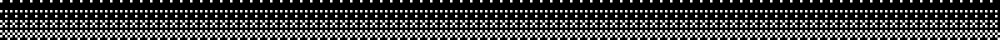

  
  
  

Hi, I'm Arhm, a third-year Honours Neuroscience student at the University of Alberta in Edmonton.

- I do undergraduate neuroscience research on how the brain regulates feeding and energy balance.
- Outside the lab, I build web apps and data analysis tools, and I take part in hackathons.
- More about my experience is on my [LinkedIn](https://www.linkedin.com/in/arhm-iqbal-ab62a1326).

  

  

  
  
  
  
  
  
  
  
  
  

  

  
  

