## About me

Hi, I'm Arhm, an Honours Neuroscience student at the University of Alberta, based in Edmonton. I like building things with code and taking part in hackathons.

## Languages

  
  
  
  
  
  
  
  
  
  
  

## Tools

**Web & infrastructure**

  
  
  
  
  
  
  
  
  
  
  
  

**Data & machine learning**

  
  

  
  
  
  
  
  
  

**Creative & hardware**

  

  
  
  

